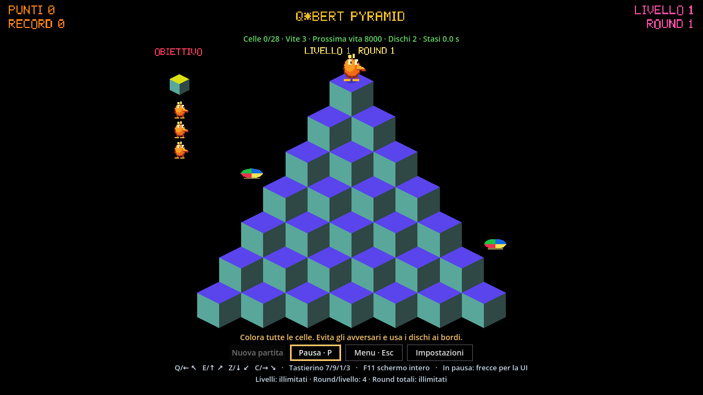

# Q*Bert Pyramid

> **WEB 1.2 — preparazione locale 1.2.0-rc.3.** L'utente ha approvato i test
> funzionali della rc.2. Nuova home arcade, pacchetti e pubblicazione attendono
> ancora approvazione. Nessuna release Web o sito è stato pubblicato.

## Scaricare e giocare Web

Dopo la pubblicazione autorizzata, aprire **Releases → Q*Bert Pyramid WEB 1.2.0**
nel repository ufficiale e scegliere **Runtime** (gioco pronto) oppure
**Complete** (gioco pronto più intero progetto). I download stabili sono ancora
proposti: non usare gli asset Windows 1.1.0 o gli ZIP automatici dei sorgenti
come se fossero il gioco Web già esportato.

Estrarre il pacchetto, entrare nella cartella con `site/` e `server/`, poi:

```bash
python3 server/serve_web.py site --port 8765 --db ../qbert-data/leaderboard.sqlite3
```

Su Windows: `py -3 server/serve_web.py site --port 8765 --db ../qbert-data/leaderboard.sqlite3`.
Aprire **http://localhost:8765/**. Sono richiesti browser desktop e Python >=3.10
con SQLite; **non serve Godot per giocare**. Non aprire index.html tramite file://.
Conservare il database esterno al sito e usare lo stesso percorso negli aggiornamenti.

- [Pacchetti, download, localhost e proprio web server](docs/DEPLOY_WEB.md)
- [Come pubblicare la release e il sito github.io](docs/GITHUB_PUBLICATION.md)
- [Note della release e stato dell'approvazione](RELEASE.md)
- [Test e accettazione](TEST.md)

GitHub Pages può ospitare la home; la classifica condivisa richiede il backend.
La proposta è collegare dalla home Pages il gioco completo su un host HTTPS
compatibile. Il servizio locale non va esposto direttamente come server pubblico.

## Sorgenti e ambiente

`scripts/` contiene GDScript (gameplay, input, presentazione e UI Godot).
`scenes/`, `assets/`, `data/` contengono scene e risorse. `web/` contiene home,
shell HTML e CSS; JavaScript nella shell integra avvio, focus e fullscreen.
`tools/` contiene Python/SQLite per API, packaging e deployment locale, Bash
per le build e PowerShell/JavaScript per le verifiche browser.

Sviluppo/verifica: VSCode, Ubuntu 22.04/WSL2, Godot **4.7.2 standard** con template
corrispondenti, Compatibility/WebGL 2, browser Chrome/Edge Windows. Nessuna
installazione o configurazione cloud è necessaria alla prova locale.
Build riproducibile: `bash tools/build_web.sh`. Output in `builds/`, ignorato da Git.
La versione Windows 1.1.0 e il suo tag restano distinti. Android, smartphone,
layout mobile del gioco, touch ed Escher sono esclusi.

## Progetto e release Windows già pubblicata


This project brings back Q*bert, an arcade classic from the 1980s that I used to play during my carefree—and now rather distant—university years.

Inspired in part by projects such as CRAFT, I wanted to try a small experiment: how far could an AI coding agent take a game project, from the initial idea to a working Windows application?

The game was built from scratch over about eight days of part-time work, using an entry-level AI coding subscription costing around $25 a month at the time. AI agents drafted much of the specification, documentation and automated tests, and generated all the game code. I didn't write a single line of game code by hand.

Gameplay references included Flash versions available on the web and a separate implementation on GitHub. These helped study the game's behavior; the code, generated graphics and sound effects were created for this project rather than extracted from those implementations.

My role was to guide the overall design, choose the direction, review the results and test the game manually on Windows. Decisions about strategy, licensing, legal considerations and security remained my responsibility.

A little trip back to the arcade, using today's tools—and a hands-on experiment in what AI coding agents can do.

## Release 1.1 — QBERT Rev. 1.1

**Q*Bert Pyramid 1.1.0** is released for Windows 11 x86_64. Coil collision
captures now use the live Q*BERT sprite's 40×48 atlas frame dimensions and feet
anchor, and play the capture voice cue. The release adds a per-user NSIS
installer alongside the portable edition.

[Download release 1.1.0](https://github.com/eruggie/qbert-pyramid/releases/tag/v1.1.0)
— [public source repository](https://github.com/eruggie/qbert-pyramid)
— [arcade games catalog](https://github.com/eruggie/80-arcade-games).

Release assets include `QBertPyramid-1.1.0-Setup.exe`,
`QBertPyramid-1.1.0-Windows-x86_64.zip`, corresponding source archive and
`QBertPyramid-1.1.0-SHA256SUMS.txt`. Verify the hash before running an asset.
The installer runs for the current Windows user and preserves saves when removed.
See [installation and updates](docs/INSTALL_WINDOWS.md) and the
[release notes](docs/releases/v1.1.0.md).

The owner reports manual Windows testing passed on 2026-11-09. Automated checks
and their scope are recorded in the release notes and [test guide](docs/TESTING.md).



Screenshot of this project's rendered game, captured under WSLg; not an image
from the reference arcade. [Image provenance](docs/screenshots/README.md).

## Controls and gameplay

| Action | Keys |
|---|---|
| Upper left | Q / Left arrow / keypad 7 |
| Upper right | E / Up arrow / keypad 9 |
| Lower left | Z / Down arrow / keypad 1 |
| Lower right | C / Right arrow / keypad 3 |
| Pause / resume | P |
| Return to menu | Esc, subject to the results-screen flow |
| Full screen | F11 |
| Navigate menus / confirm | Arrows or Tab / Enter |

Tiles use permanent, two-step or reversible color rules. There are three
initial lives, four rounds per level, twelve configured opening rounds and
continuous progression afterwards. Collect green pickups and lure the chaser
with a rescue disc. Following lost focus, explicitly resume and press movement
keys again. Audio consists of original event effects, with volume and mute.

The Italian game menu includes **Nuova partita** (New game),
**Informazioni sul gioco** (About and instructions), settings, scores,
presentation and exit. The top ten stores three-letter initials, score,
level and round. Saves are local to the Windows user.
[Player guide](docs/PLAYER_GUIDE.md).

## Build, test and repository layout

Use the verified Ubuntu 22.04 / WSL2 workflow, Godot **4.7.2 standard** and
matching export templates. With prerequisites already installed:

```bash
bash tools/doctor.sh
bash tools/test.sh
bash tools/smoke_linux.sh
bash tools/build_windows.sh # requires NSIS 3.08 (makensis)
```

The build command already runs doctor and the full tests. WSLg graphics
checks and successful exports are not Windows EXE tests.
[Build from source](docs/BUILD_FROM_SOURCE.md),
[validation record](docs/VALIDATION.md), [release checklist](docs/RELEASE_CHECKLIST.md).

- `scripts/core/`: deterministic rules, progression and player data.
- `scripts/input/`, `scripts/presentation/`, `scripts/ui/`: input, rendering and menus.
- `scenes/`, `data/`, `assets/`: game resources.
- `tests/`, `tools/`: regressions, original asset generators and packaging.
- `docs/`: current guides and historical evidence in its original language.

No cloud service or AI assistant is needed to run, build or contribute.

## Contributing and reporting

Read [CONTRIBUTING.md](CONTRIBUTING.md), [CODE_OF_CONDUCT.md](CODE_OF_CONDUCT.md)
and [SECURITY.md](SECURITY.md). For bug reports, questions and suggestions,
please open a [GitHub Issue](https://github.com/eruggie/qbert-pyramid/issues).
Issues in this public repository are public; communicate through your GitHub
account rather than sharing personal email addresses. Do not post credentials,
personal profiles or other confidential information. A private reporting channel
for sensitive matters has not yet been established.

## License, credits and reference works

Copyright (c) Eugenio Ruggieri 2026. Original project code and original
project assets are licensed under **GPL-3.0-only**, not “or later”.
See [LICENSE](LICENSE), [license scope and asset exceptions](docs/LICENSING.md)
and [third-party notices](THIRD_PARTY_NOTICES.txt). Godot and its dependencies
retain their respective licenses.

With thanks to **Warren Davis and Jeff Lee at Gottlieb**, creators of the
original Q*bert arcade game. Davis's design/programming and Lee's contribution
are documented by the [American Classic Arcade Museum](https://www.classicarcademuseum.org/q-bert)
and Davis's [GDC postmortem](https://gdcvault.com/play/1027730/Classic-Game-Postmortem-Q-bert).
Further context: [Q*bert on Wikipedia](https://en.wikipedia.org/wiki/Q*bert).

Other reference implementations, linked for context rather than included:
[Classic Games Arcade's Flash version](https://www.classicgamesarcade.com/italiano/game/21652/q-bert.html)
and [alainsmet/qbert, a JavaScript/canvas adaptation](https://github.com/alainsmet/qbert).
No code or assets from the latter were incorporated during this preparation.
A link is not a license to redistribute a reference work.

This is an independent, unofficial project, not endorsed by the original creators
or trademark holders. Q*bert and other third-party names, trademarks, images and
sounds remain the property of their respective owners.

The GPL license applies only to material that this project is authorized to
license; it does not grant any trademark rights or authorize the copying of
unrelated copyrighted works. No guarantees are provided regarding authorization
from third parties.

For a potential rights-related issue, please open a
[GitHub Issue](https://github.com/eruggie/qbert-pyramid/issues) identifying the
material concerned. Include only information suitable for public disclosure;
do not upload confidential documents or personal contact details. If private
communication is needed, request a private contact route without posting the
sensitive material. This notice does not itself grant third-party rights or
cure an infringement.

## Citation

**Please prominently credit this project when reusing its source code**, and
use the citation below in research or project documentation. Preserve the
copyright, license and notices required by GPL-3.0-only. This citation request
does not add a new restriction or change the GPL license.

```bibtex
@software{ruggieri2026qbertpyramid,
  author = {Ruggieri, Eugenio},
  title = {{Q*Bert Pyramid}},
  year = {2026},
  version = {1.1.0},
  url = {https://github.com/eruggie/qbert-pyramid},
  note = {Independent Godot implementation}
}
```

[CITATION.cff](CITATION.cff) provides machine-readable citation metadata.
Release sources are identified by tag `v1.1.0` in the public repository.
