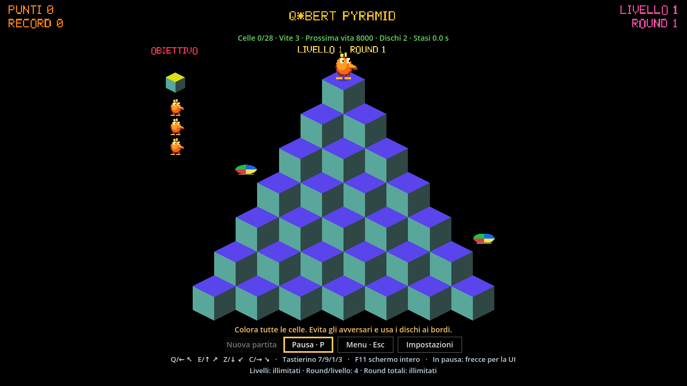

# Q*Bert Pyramid

This project brings back Q*bert, an arcade classic from the 1980s that I used to play during my carefree—and now rather distant—university years.

Inspired in part by projects such as CRAFT, I wanted to try a small experiment: how far could an AI coding agent take a game project, from the initial idea to a working Windows application?

The game was built from scratch over about eight days of part-time work, using an entry-level AI coding subscription costing around $25 a month at the time. AI agents drafted much of the specification, documentation and automated tests, and generated all the game code. I didn't write a single line of game code by hand.

Gameplay references included Flash versions available on the web and a separate implementation on GitHub. These helped study the game's behavior; the code, generated graphics and sound effects were created for this project rather than extracted from those implementations.

My role was to guide the overall design, choose the direction, review the results and test the game manually on Windows. Decisions about strategy, licensing, legal considerations and security remained my responsibility.

A little trip back to the arcade, using today's tools—and a hands-on experiment in what AI coding agents can do.

## Status and downloads

**QBERT Rev. 1.0 — version 1.0.0** is the first public release for Windows 11 x86_64.

[Download the Windows release](https://github.com/eruggie/qbert-pyramid/releases/tag/v1.0.0)
— [source repository](https://github.com/eruggie/qbert-pyramid)
— [arcade games catalog](https://github.com/eruggie/80-arcade-games).

The Windows package includes the game, licenses, installation instructions,
corresponding sources and SHA-256 checksums. See the
[installation guide](docs/INSTALL_WINDOWS.md) to choose and verify the correct download.



Screenshot of this project's rendered game, captured under WSLg; not an image
from the reference arcade. [Image provenance](docs/screenshots/README.md).

## Play on Windows

The supported release target is **Windows 11 x86_64** with the Compatibility
renderer and an OpenGL 3.3-capable driver. Windows testing reported so far
used a Core Ultra 9 275HX / RTX 5070 Laptop system; no minimum hardware or
frame-time guarantee has been established. Windows 10, ARM, Linux game
releases, web and Android are not claimed as supported targets.

To play:

1. Download its **Windows binary ZIP**, not GitHub's automatic source archive.
2. Verify its SHA-256 against the published checksum.
3. Extract the entire ZIP and launch `QBertPyramid.exe`.
4. Keep `QBertPyramid.pck`, licenses and supporting files beside the EXE.

Players do not need Godot, Git, WSL, VS Code, Python or Codex.
[Complete installation, update, removal and troubleshooting](docs/INSTALL_WINDOWS.md).

## Controls and gameplay

| Action | Keys |
|---|---|
| Upper left | Q / Left arrow / keypad 7 |
| Upper right | E / Up arrow / keypad 9 |
| Lower left | Z / Down arrow / keypad 1 |
| Lower right | C / Right arrow / keypad 3 |
| Pause / resume | P |
| Return to menu | Esc, subject to the results-screen flow |
| Full screen | F11 |
| Navigate menus / confirm | Arrows or Tab / Enter |

Tiles use permanent, two-step or reversible color rules. There are three
initial lives, four rounds per level, twelve configured opening rounds and
continuous progression afterwards. Collect green pickups and lure the chaser
with a rescue disc. Following lost focus, explicitly resume and press movement
keys again. Audio consists of original event effects, with volume and mute.

The Italian game menu includes **Nuova partita** (New game),
**Informazioni sul gioco** (About and instructions), settings, scores,
presentation and exit. The top ten stores three-letter initials, score,
level and round. Saves are local to the Windows user.
[Player guide](docs/PLAYER_GUIDE.md).

## Build, test and repository layout

Use the verified Ubuntu 22.04 / WSL2 workflow, Godot **4.7.2 standard** and
matching export templates. With prerequisites already installed:

```bash
bash tools/doctor.sh
bash tools/test.sh
bash tools/smoke_linux.sh
bash tools/build_windows.sh
```

The build command already runs doctor and the full tests. WSLg graphics
checks and successful exports are not Windows EXE tests.
[Build from source](docs/BUILD_FROM_SOURCE.md),
[validation record](docs/VALIDATION.md), [release checklist](docs/RELEASE_CHECKLIST.md).

- `scripts/core/`: deterministic rules, progression and player data.
- `scripts/input/`, `scripts/presentation/`, `scripts/ui/`: input, rendering and menus.
- `scenes/`, `data/`, `assets/`: game resources.
- `tests/`, `tools/`: regressions, original asset generators and packaging.
- `docs/`: current guides and historical evidence in its original language.

No cloud service or AI assistant is needed to run, build or contribute.

## Contributing and reporting

Read [CONTRIBUTING.md](CONTRIBUTING.md), [CODE_OF_CONDUCT.md](CODE_OF_CONDUCT.md)
and [SECURITY.md](SECURITY.md). For bug reports, questions and suggestions,
please open a [GitHub Issue](https://github.com/eruggie/qbert-pyramid/issues).
Issues in this public repository are public; communicate through your GitHub
account rather than sharing personal email addresses. Do not post credentials,
personal profiles or other confidential information. A private reporting channel
for sensitive matters has not yet been established.

## License, credits and reference works

Copyright (c) Eugenio Ruggieri 2026. Original project code and original
project assets are licensed under **GPL-3.0-only**, not “or later”.
See [LICENSE](LICENSE), [license scope and asset exceptions](docs/LICENSING.md)
and [third-party notices](THIRD_PARTY_NOTICES.txt). Godot and its dependencies
retain their respective licenses.

With thanks to **Warren Davis and Jeff Lee at Gottlieb**, creators of the
original Q*bert arcade game. Davis's design/programming and Lee's contribution
are documented by the [American Classic Arcade Museum](https://www.classicarcademuseum.org/q-bert)
and Davis's [GDC postmortem](https://gdcvault.com/play/1027730/Classic-Game-Postmortem-Q-bert).
Further context: [Q*bert on Wikipedia](https://en.wikipedia.org/wiki/Q*bert).

Other reference implementations, linked for context rather than included:
[Classic Games Arcade's Flash version](https://www.classicgamesarcade.com/italiano/game/21652/q-bert.html)
and [alainsmet/qbert, a JavaScript/canvas adaptation](https://github.com/alainsmet/qbert).
No code or assets from the latter were incorporated during this preparation.
A link is not a license to redistribute a reference work.

This is an independent, unofficial project, not endorsed by the original creators
or trademark holders. Q*bert and other third-party names, trademarks, images and
sounds remain the property of their respective owners.

The GPL license applies only to material that this project is authorized to
license; it does not grant any trademark rights or authorize the copying of
unrelated copyrighted works. No guarantees are provided regarding authorization
from third parties.

For a potential rights-related issue, please open a
[GitHub Issue](https://github.com/eruggie/qbert-pyramid/issues) identifying the
material concerned. Include only information suitable for public disclosure;
do not upload confidential documents or personal contact details. If private
communication is needed, request a private contact route without posting the
sensitive material. This notice does not itself grant third-party rights or
cure an infringement.

## Citation

**Please prominently credit this project when reusing its source code**, and
use the citation below in research or project documentation. Preserve the
copyright, license and notices required by GPL-3.0-only. This citation request
does not add a new restriction or change the GPL license.

```bibtex
@software{ruggieri2026qbertpyramid,
  author = {Ruggieri, Eugenio},
  title = {{Q*Bert Pyramid}},
  year = {2026},
  version = {1.0.0},
  url = {https://github.com/eruggie/qbert-pyramid},
  note = {Independent Godot implementation}
}
```

[CITATION.cff](CITATION.cff) provides machine-readable citation metadata.
Release sources are identified by tag `v1.0.0` in the public repository.
